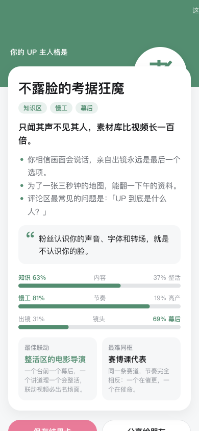

<div align="center">

# toy-maker

**给 AI 编程助手用的 B站 Toy 创作技能（Agent Skill）：从「我有个点子」到「可上传的发布包」，一条龙。**

先看 Toy 广场现在什么在火，再把你的想法打磨成方案，然后写代码、接 SDK、查合规、打好三种上传包，最后交给官方 CLI 发布。

[](LICENSE)


[它能做什么](#它能做什么) · [效果展示](#效果展示) · [快速开始](#快速开始) · [工作流程](#工作流程) · [常见问题](#常见问题)

</div>

---

## 为什么需要它

[B站 Toy](https://www.bilibili.com/toy/intro) 是 B站的互动内容形态：一个跑在 `bilibili.com/toy/<地址>/` 下的网页包，可以是人格测试、小游戏、工具、生成器、攻略图鉴……很多 UP 主用 AI 来写 Toy，但 AI 不了解这个平台：

- **SDK 文档要登录有 Toy 权限的账号才能看**，AI 平时看不到，只能猜方法名——我们实测，没有这份知识的 AI 会写出 `toy.cloudSave.set()`、`toy.setOrientation()` 这类不存在的接口，代码在 App 里一跑就报错；
- **不知道平台规则**：入口 `index.html` 不能超过 1MB、只有白名单后缀的文件会被发布、昵称不能让用户自己填、不能跳站外、关注不能锁主线……这些都是过审前才会撞上的坑；
- **不知道什么能火**：做什么类型、对标谁、首屏怎么设计、为什么测试类评论多而工具类收藏多。

toy-maker 把这些知识、数据和流程打包成一个 Skill，装上之后你的 AI 助手就像一个做过很多 Toy 的搭档。

## 它能做什么

<table>
<tr>
<td width="50%" valign="top">

**🔎 实时对标 Toy 广场**<br>
每次构思前自动抓取 [Toy 广场](https://www.bilibili.com/btoy/square) 的本周必玩、上升最快、今日推荐、7 个分类排行，并按你的题材搜同类作品。免登录、零依赖，抓不到就用内置快照兜底。

</td>
<td width="50%" valign="top">

**🧭 7 类 Toy 都有手册**<br>
测试、工具、游戏、互动玩法、攻略、合集、整活/生成器各一份手册：怎么搭结构、首屏怎么设计、怎么留住人、适合哪些 SDK 能力、有哪些合规坑。不会把所有点子都做成游戏。

</td>
</tr>
<tr>
<td valign="top">

**🎯 方案定稿 + 官方运营方法**<br>
想法确定后，按「目标背后的目标 → 像做过爆款的人那样补齐细节 → 多角色挑错」走一遍，产出带真实对标链接、量化目标、视频联动、SDK 清单和合规预审的 `toy-plan.md`；运营部分直接用官方《Toy 运营白皮书》的数据（如「可晒产物」破 10 万命中率 62%、横屏挂链导流 8.6 倍、四阶平台助推门槛）。

</td>
<td valign="top">

**🧩 SDK 接入不再靠猜**<br>
云存档、排行榜、共享存档、昵称头像、关注/充电/三连检测、分享、二维码、存相册、横竖屏与沉浸、安全区、摄像头麦克风、输入内容检测——13 个场景的现成写法，外加本地自动 mock 的桥接层 `toy-bridge.ts`。

</td>
</tr>
<tr>
<td valign="top">

**🛡️ 合规自查**<br>
`toy_maker_check.py` 扫描构建产物：入口 1MB、SDK 是否引入、App 专属能力有没有降级、轮询限流、输入框、站外链接、第三方登录/收款/广告/统计代码、白名单外的文件等。

</td>
<td valign="top">

**📦 发布留档包**<br>
`make_release.py` 把产物整理成官方发布页的三种上传形态（ZIP / 单个 HTML / 文件夹），附封面图标、源码备份、`发布信息.md`（表单怎么填 + 可直接运行的 CLI 命令）和带 sha256 的清单。

</td>
</tr>
</table>

## 效果展示

下面是在测试中，装了 toy-maker 的 AI 收到一句话「帮我做一个『你是哪种 B站 UP 主』的人格测试 Toy：12 道题、8 种结果，结果页要能存图分享」后，自己做出来的作品（未经人工修改，本地用 mock 运行截图）：

<div align="center">

&nbsp;&nbsp;

&nbsp;&nbsp;

</div>

它在动手前先跑了广场对标（找出了同类头部作品，并发现「UP 主类型」这个角度几乎没人做），按测试类手册设计了「首屏一句话钩子」「结果卡 + 二维码」「去评论区晒出你的类型」，选了「测试」分类（选「游戏」未成年人就玩不了），没有放任何昵称输入框，最后生成了三种上传形态的发布留档包。

### 测试结果

我们用 6 个真实开发场景测试，每个场景分别让 AI 在不同条件下完成同一个任务，按客观检查项打分：

| 对比 | 装 toy-maker | 对照组 | 差距主要在 |
| --- | --- | --- | --- |
| 第一轮：存档排行榜、横屏适配、合规改方案 | **22/22** | 不装 skill：9/22（42%） | 不装时 SDK 方法名全靠猜，接口不存在 |
| 第二轮：想法→方案、写人格测试、UGC 梗转盘 | **21/21** | 旧版 skill：15/21（72%） | 真实对标与数据日期、量化目标、发布留档包 |

测试用例都在 [`skills/toy-maker/evals/`](skills/toy-maker/evals/)，可以用 `claude plugin eval` 复现。

## 快速开始

### 1. 安装

推荐用 [skills](https://github.com/vercel-labs/skills) 命令一键安装（支持 Claude Code、Codex、Cursor 等几十种 AI 编程助手）：

```bash
npx skills add Olivia295/toy-maker
```

建议同时装上 B站官方的发布 skill，toy-maker 负责「做好」，官方 skill 负责「发出去」：

```bash
npx -y skills add bilibili/toy --skill toy -g -y
```

<details>
<summary>手动安装（不用 npx）</summary>

```bash
git clone https://github.com/Olivia295/toy-maker.git
mkdir -p ~/.claude/skills
cp -R toy-maker/skills/toy-maker ~/.claude/skills/
```

其他助手把 `skills/toy-maker` 目录放进它读取 skill 的目录即可（如 Codex 的 `~/.agents/skills/`）。

</details>

### 2. 关于随附的官方 SDK 文档

> [!IMPORTANT]
> 本仓库附带了两份 **B站官方文档原文**：`skills/toy-maker/references/sdk-api.md`（Toy JS SDK 能力清单）和 `skills/toy-maker/assets/toy.d.ts`（SDK 类型声明）。
> 它们来自 [Toy 开放能力页](https://www.bilibili.com/toy/publish/sdk) 的「下载 Markdown」「下载 toy.d.ts」——该页面**需要登录有 Toy 权限的账号才能查看**。文件于 2026-10-28 下载，原样收录（仅在文件顶部加了来源注释），版权归哔哩哔哩所有，不适用本仓库的 MIT 许可证。如权利方要求，我们会立即移除。

SDK 在持续更新，**以线上最新版本为准**。有 Toy 权限的话，建议用前重新下载覆盖一次：

| 官网下载的文件 | 覆盖到 |
| --- | --- |
| `toy-js-sdk-abilities.md` | `skills/toy-maker/references/sdk-api.md` |
| `toy.d.ts` | `skills/toy-maker/assets/toy.d.ts` |

AI 发现文档里没有某个能力、或日期太旧时，也会提醒你更新。

### 3. 直接用自然语言提需求

不需要记任何命令，像这样跟你的 AI 助手说就行：

- 「我是做原神攻略的 UP 主，想做个规划每周体力的 Toy，有没有搞头？帮我出个方案」
- 「帮我做一个『你是哪种 XX』的人格测试 Toy，结果页要能存图分享」
- 「我的 Phaser 游戏在 B站 App 里要横屏全屏，按钮被顶部胶囊挡住了」
- 「这个 Toy 设计能过审吗？」
- 「项目做完了，帮我打包发布」

## 工作流程


| 步骤 | AI 会做什么 |
| --- | --- |
| 看广场 | 跑 `fetch_square.py`，读出当下热门和同题材作品，用「爆款规律」框架解读；高游玩但贴着红线的作品不拿来对标 |
| 定类型 | 按你想要的体验推荐 7 类之一，读对应手册 |
| 方案定稿 | 找到目标背后的目标，补齐首屏、核心循环、回访理由、可传播产出、视频方案、SDK 清单、合规预审，给出「野心目标」，等你确认 |
| 开发 | 相对路径、hash 路由、入口 ≤1MB、contenthash；用 `toy-bridge.ts` 接 SDK，本地自动 mock；横屏、安全区、频率限制都按官方要求处理 |
| 自查 | 静态扫描 SDK 用法和合规风险，ERROR 先修，WARN 逐条讲给你听 |
| 打包留档 | 生成三种上传形态 + 封面图标 + 源码 + `发布信息.md` + `manifest.json` |
| 发布 | 交给官方 `toy` CLI：先出预览链接，你明确确认后才提交审核 |
| 运营 | 按官方运营白皮书：转公开发布、横屏演示 + 竖屏切片 + 小站帖挂链、对照四阶助推门槛、每次迭代重发视频 |

## 仓库里有什么

```
skills/toy-maker/
├── SKILL.md                     # 主流程（AI 读的入口）
├── references/
│   ├── hit-patterns.md          # 爆款规律：赛道格局、首屏、题材、SDK 使用、互动信号、长期运营
│   ├── playbooks/               # 7 类 Toy 手册：test / tool / game / interactive-play / guide / collection / meme-generator
│   ├── ops-whitepaper.md        # 官方《Toy 运营白皮书》要点：选题、传播、四阶助推、长线运营、运营清单
│   ├── final-plan.md            # 方案定稿流程与模板
│   ├── recipes.md               # 13 个 SDK 功能的写法
│   ├── platform-rules.md        # 官方 FAQ 的开发者向整理（打包、兼容、数据、合规、审核、增长）
│   ├── publish-guide.md         # 官方发布指南、文件白名单、使用协议要点
│   ├── sdk-api.md               # 【官方原文】Toy JS SDK 能力清单（需登录才能查看，见上文说明）
│   └── showcase.md              # 广场快照（离线兜底）
├── scripts/
│   ├── fetch_square.py          # 抓取 Toy 广场（免登录、零依赖）
│   ├── toy_maker_check.py       # 构建产物的 SDK 与合规自查
│   └── make_release.py          # 生成三种上传形态的发布留档包
├── assets/
│   ├── toy.d.ts                 # 【官方原文】SDK 类型声明（需登录才能查看，见上文说明）
│   ├── toy-bridge.ts            # SDK 桥接层：本地 mock、批量存档、307044 退避、横屏确认
│   └── vite.config.toy.ts       # Vite 构建模板
├── data/showcase.json           # 广场快照数据
└── evals/                       # 6 个测试用例
```

三个脚本也可以单独用：

```bash
# 看看广场现在什么在火，并搜同题材作品（输出到 ./.toy-maker/showcase.md）
python3 skills/toy-maker/scripts/fetch_square.py --search 人格测试 塔防

# 检查构建产物
python3 skills/toy-maker/scripts/toy_maker_check.py dist

# 生成发布留档包
python3 skills/toy-maker/scripts/make_release.py dist --title "我的 Toy" --slug my-toy \
  --category TEST --poster cover.png --icon icon.png --source .
```

<details>
<summary>fetch_square.py 的真实输出</summary>

```text
本周必玩 第9期：11 个
今日推荐：18 个
分类 游戏：共 1963 个，取前 20
分类 互动玩法：共 316 个，取前 20
分类 工具：共 462 个，取前 20
分类 测试：共 126 个，取前 20
分类 攻略：共 49 个，取前 20
分类 合集：共 35 个，取前 20
分类 其他：共 477 个，取前 20
搜索「人格测试」：20 个
已抓取：.toy-maker/showcase.json
摘要：.toy-maker/showcase.md
```

</details>

<details>
<summary>make_release.py 生成的留档目录</summary>

```text
release/up-persona-20261029-0014/
├── 1-zip/up-persona.zip        # 发布方式一：拖拽 ZIP
├── 2-html/index.html           # 发布方式二：拖拽单个 HTML（能安全内联时才生成，否则写明原因）
├── 3-folder/up-persona/        # 发布方式三：选择文件夹
├── cover.png / icon.png        # 已校验格式与尺寸
├── source-up-persona.zip       # 源码备份（不含 node_modules / dist / .git）
├── 发布信息.md                  # 表单内容、三种上传步骤、CLI 命令、自查结果
└── manifest.json               # 每个文件的大小与 sha256
```

</details>

## 常见问题

<details>
<summary>只能做游戏吗？</summary>

不是。toy-maker 覆盖测试、工具、游戏、互动玩法、攻略、合集、整活/生成器 7 类，还会根据你的想法建议更合适的类型——比如全年龄的轻互动建议选「互动玩法」，因为选了「游戏」分类未成年人就不能玩。

</details>

<details>
<summary>抓取广场需要登录吗？会不会被封？</summary>

不需要登录。`fetch_square.py` 用的是 Toy 广场网页自己调用的公开只读接口，一次运行十几个请求、带间隔。接口拿不到时（断网、改版、风控）自动退回内置快照并标注日期，不影响后续步骤。

</details>

<details>
<summary>仓库里的官方 SDK 文档是哪来的？过期了怎么办？</summary>

来自 Toy 开放能力页的官方下载（需要登录有 Toy 权限的账号），原样收录、版权归哔哩哔哩，详见[第 2 步](#2-关于随附的官方-sdk-文档)。过期时按同一节的表格重新下载覆盖即可。

</details>

<details>
<summary>它会替我发布吗？</summary>

不会自作主张。toy-maker 负责把发布包和 CLI 命令准备好；真正发布时交给官方 `toy` CLI，先生成预览链接，只有你明确确认后才加 `--yes` 提交审核。

</details>

<details>
<summary>广场数据和规则过时了怎么办？</summary>

广场数据每次使用时实时抓取；规律类内容（`hit-patterns.md`、各类型手册）是结构性的，变化较慢。SDK 有新能力时按 `SKILL.md` 末尾「刷新官方文档」重新下载即可。欢迎提 Issue / PR 更新规则。

</details>

## 参考资料

- [Toy 平台介绍](https://www.bilibili.com/toy/intro) · [Toy 广场](https://www.bilibili.com/btoy/square)
- [发布指南](https://www.bilibili.com/toy/publish/guide) · [使用协议](https://www.bilibili.com/toy/publish/agreement) · [开放能力（SDK / CLI）](https://www.bilibili.com/toy/publish/sdk)
- [《Toy 开发者 FAQ》](https://www.bilibili.com/opus/1241171666570051585) · [《Toy 运营白皮书》](https://www.bilibili.com/toy/toy-ops-whitepaper/index.html)
- 官方发布 skill 与 CLI 封装：[bilibili/toy](https://github.com/bilibili/toy)

## 许可证

本项目自写的代码与文档使用 [MIT](LICENSE) 许可证。随附的 `sdk-api.md`、`toy.d.ts` 为哔哩哔哩官方文档原文，版权归哔哩哔哩所有，不在 MIT 授权范围内。

本项目是社区作品，与哔哩哔哩官方无关；Toy 平台的规则、审核结论与协议以官方为准。
